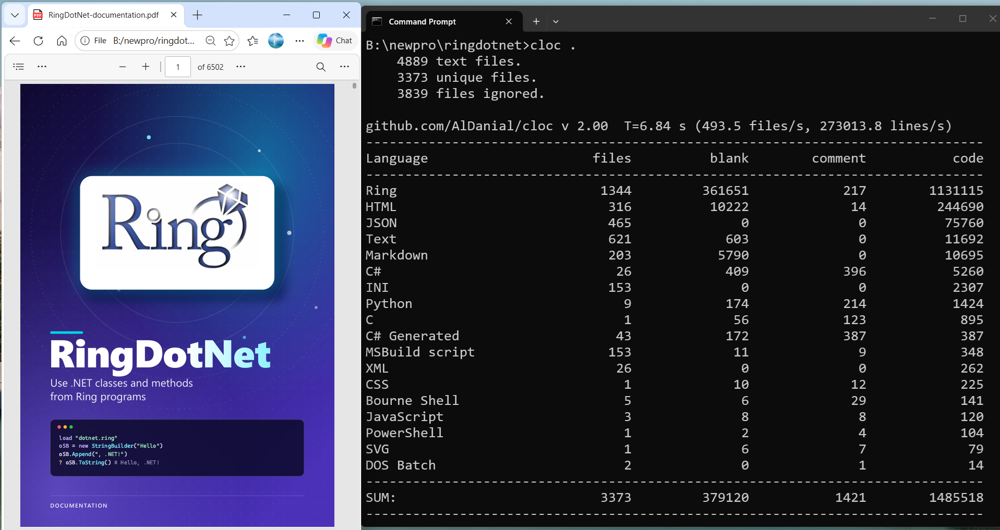
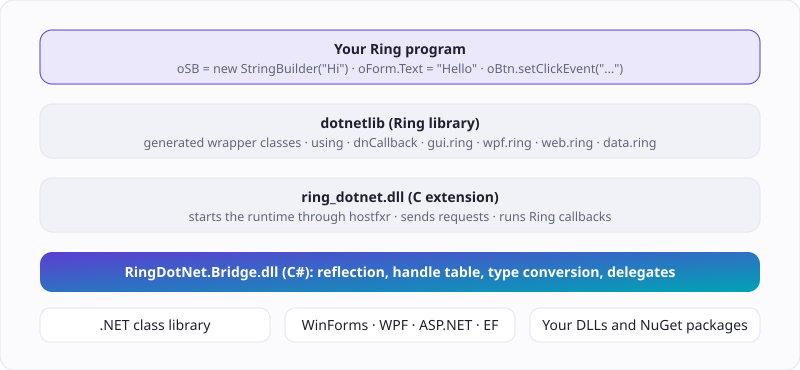

# RingDotNet

RingDotNet is a package for the Ring programming language that enables developers to use .NET classes and methods directly from Ring. 
The package hosts the .NET runtime inside the Ring process and talks to it through a small managed bridge. 
The .NET base class library, Windows Forms, WPF, ASP.NET Core, Entity Framework Core and any assembly (the framework's or your own dll, or a NuGet package) can be used from Ring with the same simple syntax.

## Install

```
ringpm install ringdotnet from ringpackages
```

RingDotNet includes over one million lines of generated Ring code, more than 6,000 pages of documentation, and a large collection of samples and applications.

The package is tested with Ring 1.28 and .NET 9. 



## Online Documentation

URL: https://ringpackages.github.io/ringdotnet/

## Example

```ring
load "dotnet.ring"

using {
	"System"
	"System.Text"
}

? new Math().Max(3,9)                           # 9: a static method

oSB = new StringBuilder("Hello")
oSB.Append(", Ring!")
? oSB.ToString()                                # Hello, Ring!
? oSB.Length                                    # 12
```

## Architecture



## Samples and tests

`samples/UsingDotNet` has:

* `introduction`: short programs for each area,
* `Forms` and `Wpf`: one small window program for each feature,
* `applications`: complete programs (a calculator, an editor, games, a web API, a contacts book...),
* `tutorials`: the programs of the lessons, named by chapter (`chNN_name.ring`),
* `tests`: the automated tests, including tests against real NuGet packages.

## License

The RingDotNet package is released under the MIT License.
